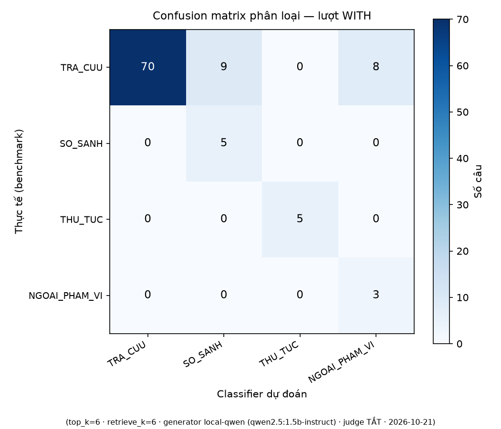
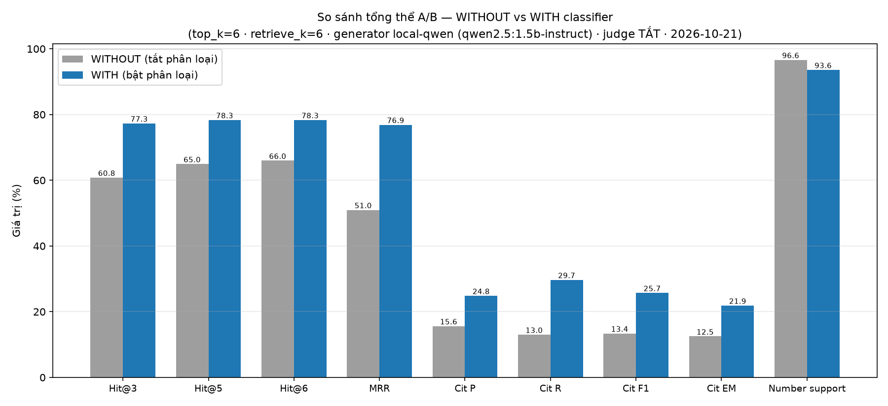
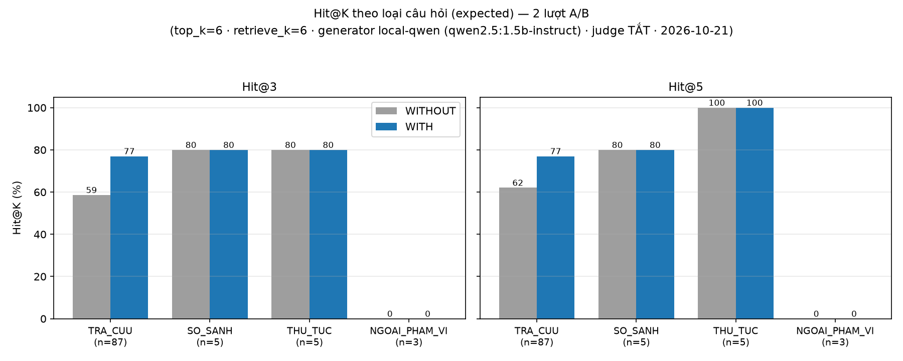

# Chương 4 — Thực nghiệm và đánh giá

> Bản nháp chương báo cáo (P5.3). Mọi số liệu chép thẳng từ nguồn ghi dưới từng
> bảng: `logs/classifier/accuracy_report.md` (P2.3) và `outputs/ab_comparison.md`
> (P4.3, nguồn gốc 2 JSON `ab_results_*.json`). Không có số liệu tự sinh.

## 4.1. Môi trường thí nghiệm

| Tham số | Lượt WITHOUT (tắt phân loại) | Lượt WITH (bật phân loại) |
|---|---|---|
| Thời điểm chạy | 2026-10-21T18:39:57 | 2026-10-21T18:40:12 |
| Benchmark | `benchmark_100_questions_v3.json` (100 câu) | (giống) |
| top_k / retrieve_k | 6 / 6 | (giống) |
| Generator | local-qwen (qwen2.5:1.5b-instruct) | (giống) |
| Local SLM (chuẩn hóa/phân loại/tách) | qwen2.5:1.5b-instruct | (giống) |
| Giám khảo Faithfulness | Tắt (`judge_enabled = false`) | (giống) |
| Embedding | BAAI/bge-m3 | (giống) |
| Truy xuất | True Hybrid Search: BM25 + ChromaDB, RRF c = 60 | (giống) |
| `with_classifier` | **false** | **true** |
| Ollama | sẵn sàng | sẵn sàng |
| Trạng thái lượt chạy | 100/100 câu, `interrupted = false` | (giống) |

Hai lượt chỉ khác đúng một biến `with_classifier` — thiết kế A/B một biến (mục 3.6).

*Nguồn: khối `meta` của `outputs/ab_results_without_classifier.json` và `outputs/ab_results_with_classifier.json`; tham số embedding/truy xuất từ `docs/architecture/SYSTEM_ARCHITECTURE.md` mục 2, 8 (cấu hình mặc định của repo, không ghi trong meta lượt chạy).*

## 4.2. Kết quả bộ phân loại (đo trước khi ghép vào pipeline)

Chạy ngày 2026-10-20 trên 100 câu raw_query của benchmark v3, model `qwen2.5:1.5b-instruct`, timeout 20 giây/câu, tổng thời gian 256,9 giây (~2,57 giây/câu).

### 4.2.1. Accuracy tổng và per-class

| Nhãn | Accuracy |
|---|---|
| Chủ đề (14 nhóm) | **85,0%** (85/100) |
| Loại câu hỏi (4 nhãn) | **81,0%** (81/100) |

| Loại | Precision | Recall | F1 | Hỗ trợ |
|---|---|---|---|---|
| TRA_CUU | 100,0% | 78,2% | 87,7% | 87 |
| SO_SANH | 33,3% | 100,0% | 50,0% | 5 |
| THU_TUC | 100,0% | 100,0% | 100,0% | 5 |
| NGOAI_PHAM_VI | 25,0% | 100,0% | 40,0% | 3 |
| **Macro-F1** | | | **69,4%** | |

Recall từng lớp hiếm đều ≥ 50% — đạt cổng P2.3. Lưu ý trung thực: precision lớp hiếm thấp (SO_SANH 33,3%, NGOAI_PHAM_VI 25,0%) nghĩa là model over-predict các lớp này; tác hại cụ thể được lượng hóa ở mục 4.4.2 ("tỉ lệ từ chối oan").

Kiểm tra lặp lại temperature = 0 (2 lượt): topic giống hệt 100/100 câu, question_type giống hệt 100/100 câu — bộ phân loại ổn định.

*Nguồn: `logs/classifier/accuracy_report.md` — các bảng "Accuracy tổng", "Per-class question_type", mục "Kiểm tra lặp lại giữa các lượt".*

### 4.2.2. Ma trận nhầm lẫn

*Nguồn: `outputs/figures/fig3_confusion.png` (P4.3 sinh từ `outputs/ab_results_with_classifier.json`).*

19/100 câu bị gán nhầm `question_type` (so với ground truth): 10 câu `TRA_CUU` → dự đoán `SO_SANH`, 9 câu `TRA_CUU` → dự đoán `NGOAI_PHAM_VI`. Lỗi chủ đề (15 câu) tập trung ở các biên mơ giữa nhóm trùng từ khóa: môn "Thực tập tốt nghiệp/Khóa luận" của CTĐT bị neo vào nhóm thực tập (Q07, Q08); "Sinh viên Giỏi" bị neo vào SV5T thay vì khen thưởng (Q34, Q37, Q38). GT-verify 5 câu sai đầu bảng: cả 5 đều có ground truth đúng, lỗi thuộc classifier — không cần sửa nhãn benchmark.

*Nguồn: `logs/classifier/accuracy_report.md` — 2 bảng lỗi + mục GT-verify; danh sách 19 câu misroute đối chiếu trong `outputs/ab_comparison.md` mục 5.*

## 4.3. Kết quả A/B bật/tắt tầng phân loại

### 4.3.1. Bảng tổng thể

| Chỉ số | WITHOUT | WITH | Chênh lệch |
|---|---|---|---|
| Hit@3 | 60,8% | 77,3% | +16,50 pp |
| Hit@5 | 65,0% | 78,3% | +13,40 pp |
| Hit@6 | 66,0% | 78,3% | +12,37 pp |
| MRR (recall window) | 0,5097 | 0,7689 | +0,26 |
| Citation Precision | 15,6% | 24,8% | +9,22 pp |
| Citation Recall | 13,0% | 29,7% | +16,67 pp |
| Citation F1 | 13,4% | 25,7% | +12,34 pp |
| Citation Exact Match | 12,5% | 21,9% | +9,38 pp |
| Number support | 96,6% | 93,6% | −3,05 pp |
| Bảo toàn thực thể | 96,7% | 96,7% | +0,00 pp |
| Faithfulness (heuristic, chỉ câu trả lời) | 0,643 (n=53) | 0,647 (n=50) | +0,004 |
| Từ chối oan (in_corpus) | 46/97 (47,4%) | 49/97 (50,5%) | +3 câu |
| Từ chối đúng (ngoài corpus) | 33,3% | 33,3% | — |
| Topic / Type accuracy (lượt WITH) | n/a | 87,0% / 83,0% | — |

Kiểm tra cổng (không giảm quá 5% tương đối): Hit@3 **+27,1%**, Hit@5 **+20,6%**, Hit@6 **+18,7%**, MRR **+50,9%** — cả bốn tăng, **GATE ĐẠT**.

*Nguồn: `outputs/ab_comparison.md` mục 1 (bảng tổng thể + bảng GATE); Faithfulness tính mean per-entry chỉ trên câu trả lời (gộp cả từ chối score 1.0 sẽ phình 0,811/0,823 — ghi chú trong cùng file).*

*Nguồn: `outputs/figures/fig1_overall.png` (P4.3).*

### 4.3.2. Theo loại câu hỏi (ground truth benchmark)

| Loại | n | Hit@3 W/O → W | MRR W/O → W | CitF1 W/O → W | Faith. trả lời W/O → W |
|---|---:|---|---|---|---|
| TRA_CUU | 87 | 58,6% → 77,0% (+18,4 pp) | 0,5008 → 0,7671 | 10,6% → 23,3% | 0,642 → 0,645 |
| SO_SANH ⚠️ | 5 | 80,0% → 80,0% (0,0) | 0,4333 → 0,8286 (+0,40) | 100,0% → 100,0% | 0,916 → 0,959 |
| THU_TUC ⚠️ | 5 | 80,0% → 80,0% (0,0) | 0,7400 → 0,7400 (0,0) | n/a | 0,516 → 0,453 |
| NGOAI_PHAM_VI ⚠️ | 3 | n/a (ngoài corpus) | 0,0000 → 0,0000 | n/a | 0,438 → 0,500 |

⚠️ nhóm n < 10 — sai số cao, chỉ đọc xu hướng.

Nhóm tăng chính là `TRA_CUU` (87 câu, 87% benchmark): Hit@3 +18,4 pp. Nhóm `SO_SANH` tăng mạnh về thứ hạng đúng (MRR 0,4333 → 0,8286) nhờ tách truy vấn con. `NGOAI_PHAM_VI` MRR = 0 ở cả hai lượt — câu ngoài corpus không có tài liệu đúng để khớp, hành vi như kỳ vọng.

*Nguồn: `outputs/ab_comparison.md` mục 2.*

*Nguồn: `outputs/figures/fig2_hit_by_type.png` (P4.3).*

### 4.3.3. Theo chủ đề

| Chủ đề | n | Hit@3 W/O → W | ΔHit@3 | MRR W/O → W |
|---|---:|---|---:|---|
| chương trình đào tạo | 22 | 45,5% → 90,9% | **+45,45** | 0,2255 → 0,9091 |
| khen thưởng sinh viên | 10 | 10,0% → 50,0% | **+40,00** | 0,1417 → 0,5000 |
| quy chế công tác sinh viên ⚠️ | 6 | 66,7% → 100,0% | +33,33 | 0,7269 → 1,0000 |
| thực tập tốt nghiệp ⚠️ | 9 | 66,7% → 100,0% | +33,33 | 0,2926 → 0,6667 |
| cuộc thi chính luận | 12 | 91,7% → 100,0% | +8,33 | 0,7708 → 1,0000 |
| học phí | 12 | 50,0% → 50,0% | 0,00 | 0,4444 → 0,5595 |
| sinh viên 5 tốt ⚠️ | 6 | 83,3% → 83,3% | 0,00 | 0,7500 → 0,8333 |
| bảo hiểm y tế ⚠️ | 2 | 100,0% → 100,0% | 0,00 | 0,7500 → 0,7500 |
| khen thưởng cấp ĐHQG ⚠️ | 2 | 50,0% → 50,0% | 0,00 | 0,2917 → 0,2917 |
| ký túc xá ⚠️ | 2 | 0,0% → 0,0% | 0,00 | 0,0000 → 0,0000 |
| tài chính sinh viên ⚠️ | 2 | 100,0% → 100,0% | 0,00 | 1,0000 → 1,0000 |
| hành chính sinh viên ⚠️ | 1 | 0,0% → 0,0% | 0,00 | 0,2000 → 0,0833 |
| thực tập chuyên đề ⚠️ | 3 | 66,7% → 33,3% | **−33,33** | 0,5667 → 0,2333 |
| đánh giá rèn luyện | 11 | 100,0% → 81,8% | **−18,18** | 1,0000 → 0,8182 |

⚠️ nhóm n < 10 — sai số cao, chỉ đọc xu hướng.

*Nguồn: `outputs/ab_comparison.md` mục 3 (bảng đầy đủ 14 chủ đề, gồm Hit@5 và CitF1 — bản chương này trích cột chính).*

### 4.3.4. Router lượt WITH — phân bố nhãn dự đoán

| Predicted | n | Hit@3 | MRR | CitF1 | Faith. trả lời |
|---|---:|---|---|---|---|
| TRA_CUU | 70 | 75,7% | 0,7534 | 15,2% | 0,637 |
| SO_SANH | 14 | 92,9% | 0,9388 | 31,7% | 0,784 |
| THU_TUC | 5 | 80,0% | 0,7400 | n/a | 0,453 |
| NGOAI_PHAM_VI | 11 | 62,5% | 0,4545 | 75,0% | 0,485 |

Phân bố dự đoán {TRA_CUU 70, SO_SANH 14, NGOAI_PHAM_VI 11, THU_TUC 5} so với expected {87, 5, 5, 3}: nhóm câu bị gán nhầm `SO_SANH`/`NGOAI_PHAM_VI` thực chất là `TRA_CUU` (10 + 9 câu). Đáng chú ý, nhóm dự đoán `SO_SANH` (14 câu) đạt Hit@3 92,9% và MRR 0,9388 — đường truy xuất SO_SANH (top_k+2 + tách truy vấn con) không hại những câu bị gán nhầm, xác nhận thiết kế guardrail "tách dở lùi đường đơn".

*Nguồn: `outputs/ab_comparison.md` mục 4.*

## 4.4. Thảo luận

### 4.4.1. Vì sao tăng

- **Chương trình đào tạo (n=22) Hit@3 45,5% → 90,9% (+45,5 pp)**: nhóm lớn nhất benchmark, lượt WITHOUT Hit@3 rất thấp (45,5%) vì cấu hình chung không đủ cửa sổ cho câu hỏi nhiều mốc (mã môn + tín chỉ + học kỳ + chuẩn đầu ra ELO); lượt WITH thu hẹp nguồn về đúng văn bản CTĐT (`ban-mo-ta-ctdt-nganh-cntt-2021.pdf`) nên ngữ cảnh cô đọng. Dẫn chứng: **Q02** ("Chuẩn đầu ra ELO 6, ELO 7, ELO 8 và ELO 9…") — chunk đúng từ rank 3 (RR 0,33) lên rank 1 (RR 1,00). Đây là quan sát **theo nhóm trong một gói thay đổi** (router + tách truy vấn con + prompt), không phải bằng chứng riêng cho lọc nguồn: trên vòng 811 item, lọc mềm so với all-off **mất 18 item** (V2, 27-10; CI cụm [−4,62; −0,69] điểm %, p=2,77e−4).
- **Khen thưởng sinh viên (n=10) Hit@3 10,0% → 50,0% (+40,0 pp)**: cùng cơ chế thu hẹp nguồn `888-qd-dhag-2022-08-08.pdf` đẩy chunk đúng lên cửa sổ top-k; cùng giới hạn diễn giải như trên (n nhỏ, nằm trong gói thay đổi).
- **SO_SANH MRR 0,4333 → 0,8286**: tách truy vấn con cho phép mỗi vế được truy xuất độc lập với từ khóa riêng, gộp lại đủ ngữ cảnh cho cả các vế (ví dụ Q02 ở trên thuộc nhóm này).

### 4.4.2. Vì sao giảm / chưa cải thiện

- **Đánh giá rèn luyện (n=11) Hit@3 100% → 81,8% (−18,2 pp)**: lượt WITHOUT đã đạt trần 100% (nhóm câu trùng 1 văn bản 1059-qd dễ truy xuất); lượt WITH 2 câu rơi khỏi top-3. Đây là nhóm duy nhất n ≥ 10 bị giảm.
- **Thực tập chuyên đề (n=3) −33,3 pp ⚠️**: n quá nhỏ, có thể chỉ 1 câu đổi chiều là đảo cả bảng — không kết luận.
- **Từ chối oan 46/97 → 49/97 (+3 câu)**: đối chiếu 19 câu misroute, 9/19 bị từ chối oan ở lượt WITH; trong đó 7 câu bị gán nhầm `NGOAI_PHAM_VI` nên prompt biến thể nhắc từ chối khớp → từ chối oan (Q08, Q12, Q36, Q46, Q48, Q60, Q86). Kết luận trung thực: misroute góp phần nhưng không phải nguyên nhân chính — cả hai lượt đều ~50% từ chối oan, phần nền do guardrail token-overlap 0,3 + khuynh hướng thận trọng của generator Qwen 1.5B, tồn tại độc lập với tầng phân loại.
- **Number support −3,05 pp**: câu trả lời dài hơn (bảng so sánh SO_SANH) làm tỉ lệ số có căn cứ giảm nhẹ — chấp nhận trong biên đo.

### 4.4.3. Hạn chế của thí nghiệm

1. **Latency không dùng để kết luận**: WITHOUT 2,30 s/câu vs WITH 7,79 s/câu chỉ tham chiếu — hai lượt có pattern cache khác nhau (lượt WITH miss nhiều ở nhóm SO_SANH do router đổi ngữ cảnh truy vấn) và chạy song song trên cùng máy.
2. **Nhãn NGOAI_PHAM_VI precision thấp (25%)**: cơ chế từ chối chuẩn của nhãn này khuếch đại từ chối oan khi gán nhầm — vì thế thiết kế **không skip truy xuất**; hướng cải thiện ở chương 5.
3. **Nhóm n nhỏ**: SO_SANH (5), THU_TUC (5), NGOAI_PHAM_VI (3) và 8 chủ đề n ≤ 6 — sai số cao, mọi bảng per-group chỉ đọc xu hướng.
4. **Faithfulness là heuristic local** (giám khảo Gemini tắt theo kịch bản offline): điểm chỉ phản ánh hỗ trợ số/ngữ cảnh, không thay thế được LLM judge; công thức chấm giống nhau cả hai lượt nên phép so sánh tương đối vẫn công bằng.
5. **Từ chối đúng ngoài corpus chỉ 33,3% ở cả hai lượt** (1/3 câu): Q96, Q98 bị trả lời thay vì từ chối (ảo giác) — giới hạn của generator 1.5B, không phụ thuộc tầng phân loại.

*Nguồn các nhận xét: `outputs/ab_comparison.md` mục 5, 6, 7.*

## 4.5. Tiểu kết

Trên cùng benchmark v3, cùng tham số, chỉ khác một biến `ENABLE_CLASSIFIER`, **gói thay đổi của lượt WITH** (router chọn tham số + thu hẹp nguồn, tách truy vấn con cho `SO_SANH`, prompt theo loại) giúp Hit@3 tăng 27,1% tương đối (60,8% → 77,3%) và MRR tăng 50,9% tương đối (0,5097 → 0,7689) mà không tụt chỉ số truy xuất nào vượt ngưỡng −5%; nhóm câu tăng rõ nhất là chương trình đào tạo (+45,5 pp) và khen thưởng sinh viên (+40,0 pp), cùng SO_SANH nhờ tách truy vấn con. **Không quy riêng cho lọc nguồn**: A/B này bật ba thay đổi cùng lúc, còn phép đo tách riêng trên vòng 811 item (V2, 27-10) cho thấy lọc mềm **−18 item** so với all-off (518 vs 536; CI cụm [−4,62; −0,69] điểm %, p=2,77e−4) và chậm 2,76 s vs 0,18 s/item. Giá phải trả được lượng hóa: 3 câu từ chối oan tăng thêm (trên nền ~50% sẵn có của generator), number support −3,05 pp — đều nằm ngoài chỉ số truy xuất là trọng tâm cổng đánh giá.
